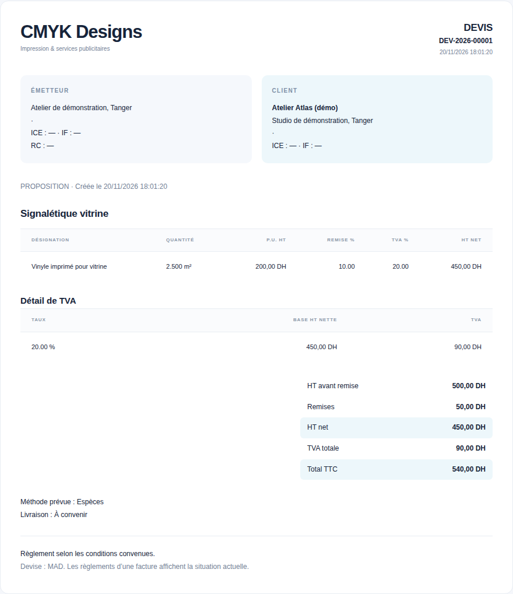
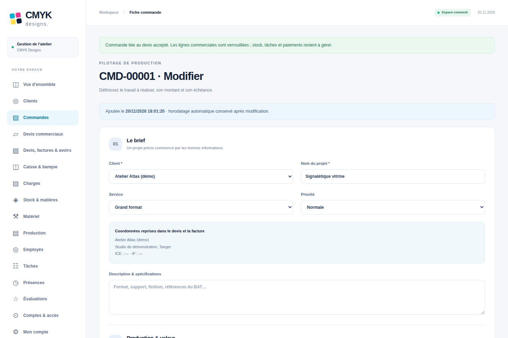
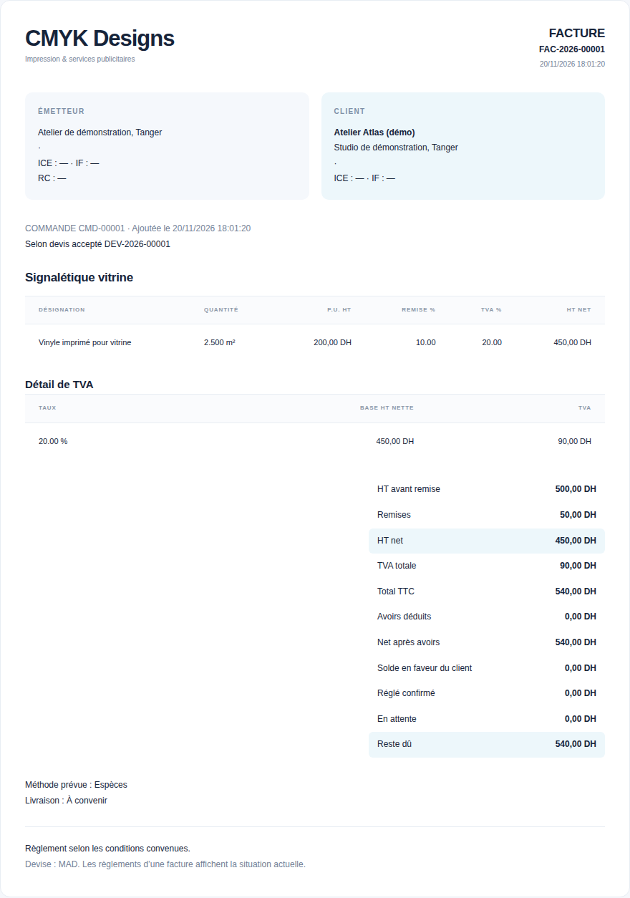
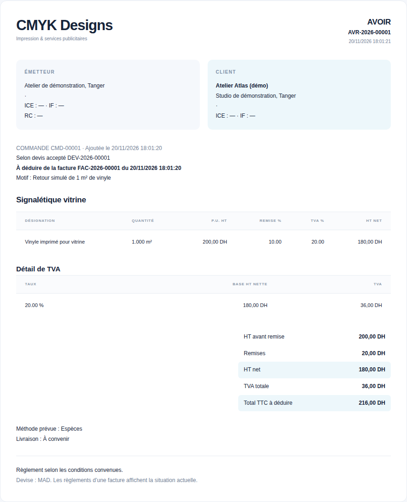

# CMYK Designs
**Print shop management software · v0.8.0 · PHP 8.2+ and MySQL/MariaDB**

A print job passes through several hands. A customer approves a quote, production tracks a job by unit or square metre, and the office issues an invoice and records payment. CMYK Designs connects those records while preserving the document originally issued to the customer. The interface is in French and prices are in Moroccan dirhams.

[Read the illustrated case study and visual guidelines (PDF)](docs/CMYK-Designs-Case-Study.pdf) · [Roadmap](ROADMAP.md) · [Release history](CHANGELOG.md)

## A print order from quote to credit

The browser walkthrough creates a fictional customer, Atelier Atlas, and follows a 2.5 m² window-vinyl order through the French-language interface. The issued invoice totals 540 DH. A 1 m² return creates a credit of 216 DH and leaves 324 DH due.

| Issued quote | Converted production order |
|---|---|
|  |  |

| Issued invoice | Partial credit note |
|---|---|
|  |  |

[Open the invoice PDF downloaded from the application](docs/demo/invoice.pdf) · [Read the browser test](tests/portfolio_walkthrough.py) · [View the walkthrough runs](../../actions/workflows/portfolio-walkthrough.yml)

## A job in figures

| Large-format print | Amount |
|---|---:|
| 2.5 m² × 200 DH/m² | 500 DH |
| Discount at 10% | −50 DH |
| Net before tax | 450 DH |
| VAT at 20% | 90 DH |
| Invoice total | **540 DH** |

A credit for 1 m² is 216 DH. The remaining 1.5 m² is worth 324 DH. Both credits refer to the original invoice. The application rejects a credit exceeding the remaining quantity.

## Explore the implementation

| Workshop task | Implementation |
|---|---|
| Prepare and issue a quote, convert it into a production order | [Quote workflow](app/quotes.php) |
| Apply discounts and VAT across multiple lines | [Line calculations](app/line_items.php) |
| Issue partial credits while preserving the original amounts | [Credit allocation](app/credits.php) |
| Reserve stock and follow material movements | [Inventory](app/inventory.php) |
| Track receipts, expenses and internal transfers | [Cash and bank](app/finance.php) |
| Manage team activity and payroll documents | [Team](app/team.php) and [payroll](app/payroll.php) |

## Run locally

1. Prepare Apache with PHP 8.2+ (64-bit), PDO MySQL, mbstring and zlib. Use a MySQL or MariaDB database and a dedicated user able to create and alter its tables. Enable Apache overrides so that the bundled access rules apply.
2. Place the project in the web root. Copy `app/config.example.php` to `app/config.php`. Set the database parameters and a random setup token of at least 32 characters. Generate a token with `php -r "echo bin2hex(random_bytes(32));"`.
3. Open `install.php` in the browser, enter the token and create the first administrator. Remove the installer after successful setup and sign in through `index.php`. For an existing installation, follow the [upgrade guide](MISE_A_JOUR_V08.html).

The distribution includes TCPDF and its [license notices](app/vendor/tcpdf/LICENSE-LGPL-3.txt). No front-end build step is required.

## Reproduce the calculation checks

From the project root, run `php tests/commercial-calculations.php` with mbstring enabled. The script checks invoice totals, both partial credits and three invalid inputs. It uses the production PHP functions and needs no database. The evaluated baseline also passed syntax checks for 41 application PHP files and the JavaScript entry point. Its schema created 25 tables in MariaDB. The browser walkthrough also checks installation, login, quote conversion, invoice PDF contents and the balance after a partial credit.
